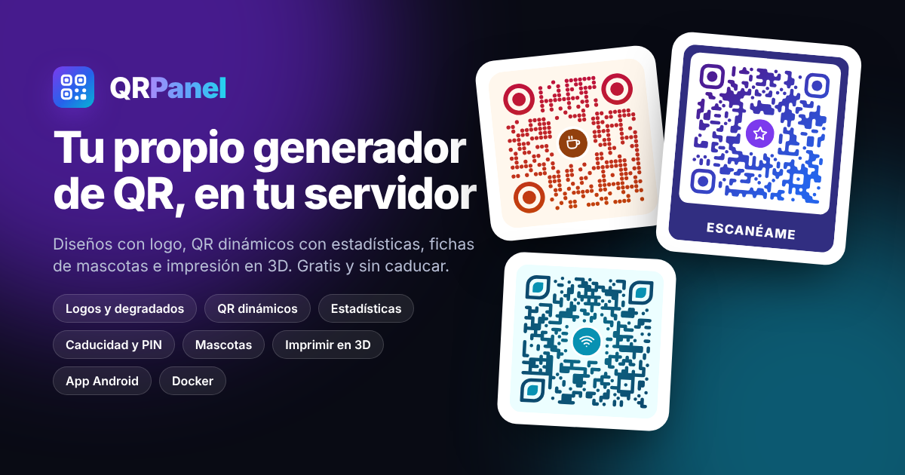
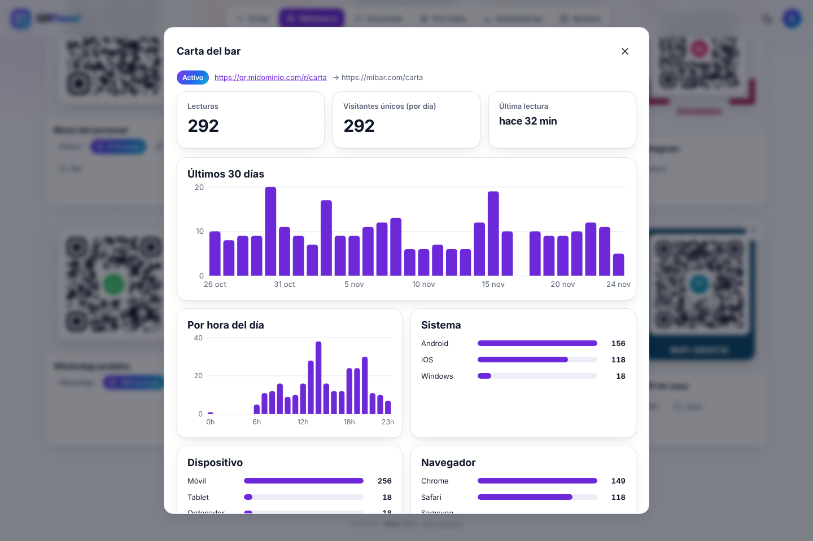
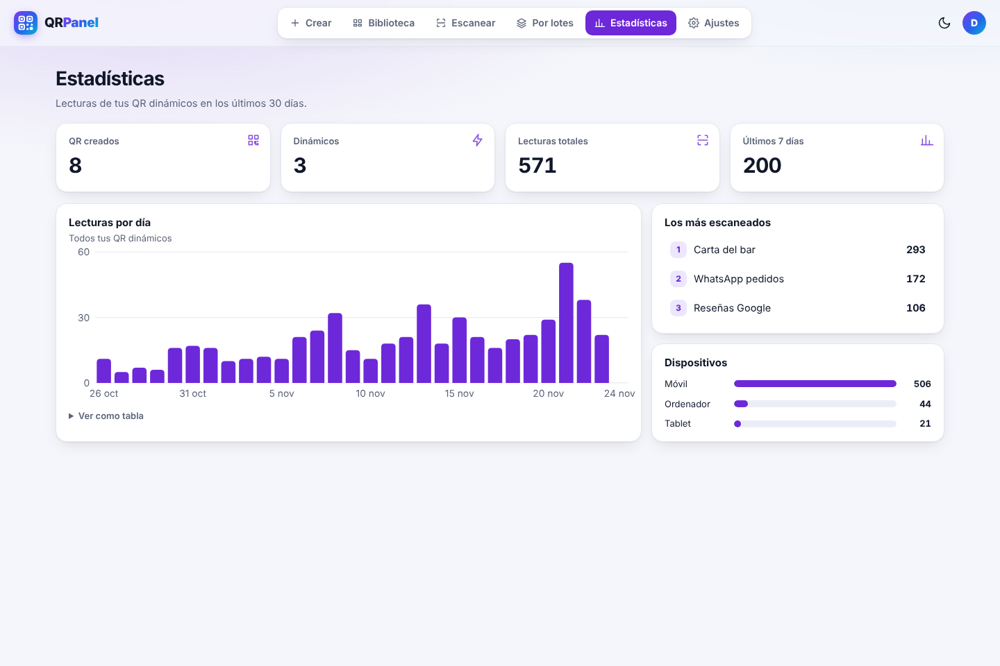
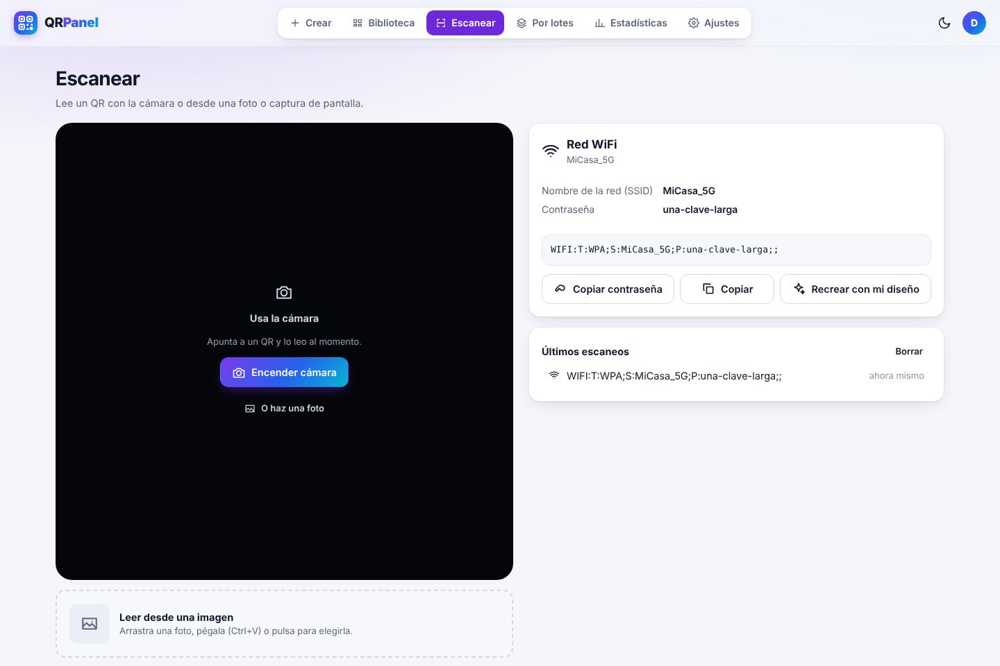
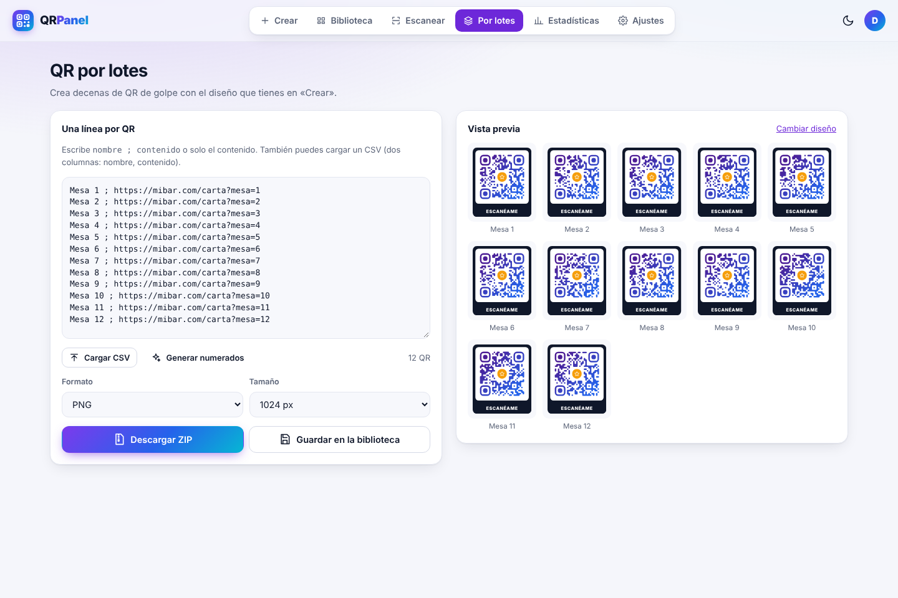
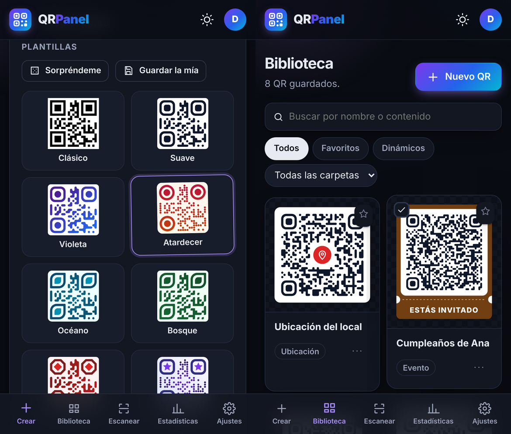
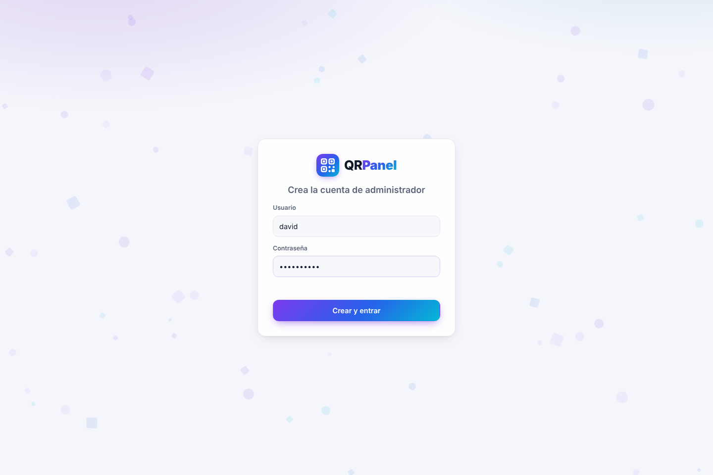

# QRPanel



Tu propio generador de códigos QR, en tu casa o en tu servidor. Haces QR bonitos (con logo,
degradados, marcos y texto), los guardas en tu biblioteca y, si quieres, los haces
**dinámicos**: cambias a dónde llevan sin reimprimirlos y ves cuántas veces los escanean.
Gratis, sin cuentas en webs de terceros y sin que tus QR dejen de funcionar cuando acaba
una "prueba gratuita". En español, con modo claro y oscuro, y se instala como app.

Funciona en una Raspberry Pi o en cualquier equipo con Docker. Gasta muy poco: unos 55 MB
de memoria.

**Qué incluye:**

- **10 tipos de QR:** enlace, texto, WiFi, contacto (vCard), email, WhatsApp, llamada, SMS,
  ubicación y evento de calendario.
- **Diseño a tu gusto:** 10 formas de módulo (cuadrado, redondeado, líquido, puntos, píxel,
  elegante, rombo, estrella, barras y líneas), 6 marcos y 7 centros para los "ojos", colores
  sólidos o con degradado lineal o radial, fondo de color, degradado o transparente, y
  esquinas redondeadas.
- **Logos:** sube tu imagen (arrastrar, pegar con Ctrl+V o elegir), usa uno de los 16
  iconos rápidos, y ajusta tamaño, espacio libre, fondo y redondeo. Tus logos se guardan
  para volver a usarlos.
- **Marcos con texto:** tarjeta, cinta arriba, bocadillo, esquinas y entrada, con tu texto,
  colores y tipo de letra.
- **12 plantillas** y botón **Sorpréndeme**, que crea un diseño al azar que siempre se lee.
  También puedes guardar tus propias plantillas.
- **Comprobación de lectura real:** mientras diseñas, QRPanel lee el QR como lo haría un
  móvil (en grande y en pequeño) y te da una nota de 0 a 100 con consejos si algo falla.
- **Descargas** en PNG, SVG (vectorial, para imprenta), JPG, WebP y PDF (A4 listo para
  imprimir), hasta 4096 px. También
  copiar la imagen, compartirla desde el móvil o copiar el texto.
- **QR dinámicos** con código corto (`/r/carta`), pausa, fecha de caducidad y máximo de
  lecturas. Si cambias el destino, el QR impreso sigue valiendo.
- **Estadísticas:** lecturas por día, por hora, por dispositivo, sistema y navegador,
  visitantes únicos y los QR más escaneados.
- **Biblioteca** con búsqueda, favoritos, carpetas, duplicar, renombrar y descarga de
  varios a la vez en un ZIP.
- **Por lotes:** pega una lista (o un CSV) y te hace decenas de QR con el mismo diseño, en
  un ZIP o guardados en la biblioteca.
- **Escáner:** lee QR con la cámara o desde una foto o captura, reconoce WiFi, contactos,
  eventos… y con un botón lo vuelve a crear con tu diseño.
- **Compartir con un enlace:** cada QR puede tener su página pública (`/s/…`) donde
  cualquiera lo ve y lo descarga en PNG, SVG, JPG o PDF sin cuenta. La quitas cuando quieras.
- **Usuarios:** el primero que se registra es el administrador; los demás piden cuenta y
  el administrador los aprueba. Cada uno ve solo sus QR.
- **Copia de seguridad:** exporta e importa todo (QR, logos y plantillas) en un archivo.
- **App instalable** en el móvil y el PC (PWA), con atajos de teclado, deshacer y rehacer.
- **Sin servidor también:** si abres la web sin el servidor detrás, funciona en "modo
  local" y guarda los QR en el navegador (sin QR dinámicos ni estadísticas).

Hecho con Python (FastAPI + SQLite) y JavaScript sin frameworks.




<details>
<summary><b>Más capturas</b></summary>

| | |
|---|---|
|  |  |
| **Biblioteca** con carpetas y favoritos | **Modo oscuro** |
|  |  |
| **Colores y degradados** | **Estadísticas** de todos tus QR |
|  |  |
| **Escáner** con cámara o imagen | **Por lotes**: muchos QR de golpe |
|  |  |
| **En el móvil** | **Página pública** para compartir un QR |
|  | |
| **Pantalla de entrada** | |

</details>

---

## Qué es un QR dinámico (y por qué te interesa)

Un QR normal lleva dentro el destino tal cual (por ejemplo `https://mibar.com/carta`). Si
mañana cambia la dirección, tienes que imprimirlo otra vez.

Un QR dinámico lleva dentro una dirección corta de **tu** QRPanel (por ejemplo
`https://qr.midominio.com/r/carta`). Cuando alguien lo escanea, QRPanel apunta la lectura y
lo manda al destino. Así puedes:

- **Cambiar el destino** cuando quieras sin reimprimir nada.
- **Ver cuántas veces lo escanean**, cuándo y desde qué tipo de móvil.
- **Pausarlo**, ponerle **fecha de caducidad** o un **máximo de lecturas**.

Las webs de QR suelen cobrar por esto, y si dejas de pagar tus QR impresos dejan de
funcionar. Con QRPanel son tuyos para siempre.

> **Importante:** para que un QR dinámico funcione en cualquier móvil, tu QRPanel tiene que
> verse desde internet (mira [Acceso desde fuera de casa](#6-acceso-desde-fuera-de-casa)) y
> tienes que poner tu **dirección pública** antes de imprimirlo. Si no, solo funcionará
> conectado a tu WiFi.

---

## 1. Requisitos

- Una Raspberry Pi 3/4/5 o cualquier equipo Linux con **Docker** y **Docker Compose**.
  Si no lo tienes: `curl -fsSL https://get.docker.com | sh` y luego
  `sudo usermod -aG docker $USER` (cierra la sesión y vuelve a entrar).
- Para los QR dinámicos, un dominio o subdominio que apunte a tu servidor (opcional).

## 2. Instalar

```bash
git clone https://github.com/pctecnikk/qrpanel.git
cd qrpanel
./install.sh       # la primera vez solo crea el archivo .env con tu usuario
nano .env          # elige DATA_DIR y, si tienes dominio, PUBLIC_URL
./install.sh       # ahora sí instala y arranca
```

La primera instalación tarda un par de minutos. La base de datos (SQLite) se crea sola
dentro de `DATA_DIR/config/` al arrancar.

**Con la imagen ya hecha** (sin compilar nada), cambia en `docker-compose.yaml` la línea
`build: .` por `image: ghcr.io/pctecnikk/qrpanel:latest` y quita `image: qr-panel:latest`.
La imagen sirve para PC (amd64) y Raspberry Pi (arm64 y arm/v7).

### Primer acceso

Abre **http://IP-DE-TU-SERVIDOR:8091** y crea tu cuenta. **El primer usuario es el
administrador.** Los siguientes quedan pendientes hasta que los apruebes en
**Ajustes → Usuarios** (ahí también creas cuentas, bloqueas, cambias contraseñas o las
eliminas).

### Instalar la app en el móvil o el PC

- **Android / Chrome / Edge:** abre QRPanel y pulsa **Ajustes → Instalar QRPanel** (o el
  menú del navegador → *Instalar aplicación*).
- **iPhone / iPad:** en Safari, **Compartir → Añadir a pantalla de inicio**.

> La cámara del escáner y la instalación como app necesitan **https** (o `localhost`). Con
> `http://192.168…` el resto funciona, pero el navegador no deja usar la cámara: en ese caso
> usa **Leer desde una imagen**.

## 3. Configuración (`.env`)

| Variable | Para qué sirve | Por defecto |
|---|---|---|
| `DATA_DIR` | Carpeta donde se guarda todo | `./data` |
| `PORT` | Puerto de la web | `8091` |
| `TZ` | Zona horaria (para las estadísticas) | `Europe/Madrid` |
| `PUID` / `PGID` | Usuario y grupo dueños de los archivos | `1000` |
| `PUBLIC_URL` | Dirección pública para los QR dinámicos (`https://qr.midominio.com`) | vacío = la de la web |
| `ADMIN_USER` / `ADMIN_PASSWORD` | Crea ese administrador al arrancar si no existe | vacío |
| `ALLOW_REGISTER` | `1` = cualquiera puede pedir cuenta (el admin la aprueba); `0` = solo el admin crea cuentas | `1` |

La dirección pública también se puede poner desde la web en **Ajustes → Dirección
pública** (tiene prioridad sobre `PUBLIC_URL`). Después de cambiar el `.env`:
`docker compose up -d`.

**Qué hay dentro de `DATA_DIR`:** solo `config/qrpanel.db`, la base de datos con usuarios,
QR, logos, plantillas y lecturas. Para hacer una copia de seguridad basta con copiar esa
carpeta (o usar **Ajustes → Copia de seguridad → Exportar**).

## 4. Actualizar

```bash
cd qrpanel
git pull
docker compose up -d --build
```

Tus QR no se tocan: están en `DATA_DIR`, no en la carpeta de la app.

## 5. Comandos útiles

```bash
docker compose ps                 # estado
docker compose logs -f            # ver registros (Ctrl+C para salir)
docker compose restart            # reiniciar
docker compose down               # parar
```

## 6. Acceso desde fuera de casa

Para que los QR dinámicos funcionen con datos móviles, QRPanel tiene que verse desde
internet con **https**. No abras el puerto 8091 directamente en el router: usa un proxy
inverso con HTTPS (Caddy, Nginx Proxy Manager, Traefik, Pangolin, Cloudflare Tunnel…) que
apunte a `http://IP-DE-TU-SERVIDOR:8091`. Luego pon esa dirección en
**Ajustes → Dirección pública**.

Ejemplo con Caddy:

```
qr.midominio.com {
    reverse_proxy 192.168.1.50:8091
}
```

## 7. Seguridad

- Las contraseñas se guardan como hash PBKDF2, nunca tal cual.
- Tras varios intentos fallidos de entrar se bloquea un rato a quien lo intenta.
  Si no quieres que desconocidos pidan cuenta, pon `ALLOW_REGISTER=0`.
- Cambiar la contraseña cierra las demás sesiones abiertas.
- Los QR dinámicos solo pueden llevar a direcciones `https://`, `http://`, `mailto:`,
  `tel:`, `sms:` y `geo:` (nunca código).
- Las lecturas no guardan la IP: solo un identificador anónimo por día para contar
  visitantes únicos. Se borran solas a los dos años.
- La web lleva una política de seguridad estricta (CSP) y no carga nada de fuera.

## 8. Licencia

QRPanel se publica con la licencia [PolyForm Noncommercial 1.0.0](LICENSE.md). En resumen
(el texto que vale es el de la licencia):

- ✅ Puedes usarlo gratis en tu casa, para ti, tu familia, tus amigos, un colegio o una
  asociación sin ánimo de lucro.
- ✅ Puedes ver el código, modificarlo y compartir tus cambios, siempre que mantengas el
  aviso de licencia y de autor.
- ❌ **No puedes venderlo** ni usarlo con fines comerciales (por ejemplo cobrar por
  instalarlo u ofrecerlo como servicio de pago).

Si quieres usarlo con fines comerciales, escribe al autor por GitHub.

Incluye dos bibliotecas de terceros con sus propias licencias: *qrcode-generator*
(Kazuhiko Arase, MIT) y *jsQR* (Cosmo Wolfe, Apache 2.0). Mira
[`app/static/vendor/LICENSES.txt`](app/static/vendor/LICENSES.txt).
"QR Code" es una marca registrada de DENSO WAVE INCORPORATED.

Copyright (c) 2026 [pctecnikk](https://github.com/pctecnikk)
