# QRPanel


Tu propio generador de códigos QR, en tu casa o en tu servidor. Haces QR bonitos (con logo,
degradados, marcos y texto), los guardas en tu biblioteca y, si quieres, los haces
**dinámicos**: cambias a dónde llevan sin reimprimirlos y ves cuántas veces los escanean.
Gratis, sin cuentas en webs de terceros y sin que tus QR dejen de funcionar cuando acaba
una "prueba gratuita". En español y en inglés, con modo claro y oscuro, y se instala como app.

Funciona en una Raspberry Pi o en cualquier equipo con Docker. Gasta muy poco: unos 55 MB
de memoria.

> **Idiomas / Languages:** español e inglés. La web usa el idioma de tu navegador y se cambia en
> **Ajustes → Idioma / Language** o en la pantalla de entrada. Las páginas públicas (carta, ficha
> de la mascota, compartir…) salen en el idioma del móvil de quien escanea. La app de Android
> sigue a la web.
> Spanish and English. The web follows your browser language and can be changed in
> **Settings → Idioma / Language** or on the sign-in screen. Public pages (menu, pet profile,
> share…) follow the language of the phone that scans them. The Android app follows the web.

**Qué incluye:**

- **18 tipos de QR:** enlace, texto, WiFi, contacto (vCard), email, WhatsApp, llamada, SMS,
  ubicación, fecha al calendario y **mascota**: una ficha con foto y tus datos por si se
  pierde, con botones para llamarte, mandarte un WhatsApp o enviarte dónde está (y cartel
  «Se busca» en A4 o para redes).
- **Para negocios**, con su página en el móvil que cambias sin reimprimir:
  **restaurante** (carta con alérgenos y QR por mesa), **reseñas** (directo a Google o
  TripAdvisor, con **expositor de mesa 3D** multicolor y aristas redondeadas), **hotel**
  (WiFi, horarios, servicios y QR por habitación), **oficina / recepción** (contactos y aviso de
  llegada), **tienda / producto**, **evento con programa** (cuenta atrás y «Añadir al
  calendario») e **inmobiliaria** (ficha del piso y «Pedir visita»).
- **Encuadra las fotos** al subirlas (mover y zoom), para que la mascota o el producto no
  salgan cortados.
- **Diseño a tu gusto:** 10 formas de módulo (cuadrado, redondeado, líquido, puntos, píxel,
  elegante, rombo, estrella, barras y líneas), 6 marcos y 7 centros para los "ojos", colores
  sólidos o con degradado lineal o radial, fondo de color, degradado o transparente, y
  esquinas redondeadas.
- **Logos:** sube tu imagen (arrastrar, pegar con Ctrl+V o elegir), usa uno de los 17
  iconos rápidos, y ajusta tamaño, espacio libre, fondo y redondeo. Tus logos se guardan
  para volver a usarlos.
- **Marcos con texto:** tarjeta, cinta arriba, bocadillo, esquinas y entrada, con tu texto,
  colores y tipo de letra.
- **12 plantillas** y botón **Sorpréndeme**, que crea un diseño al azar que siempre se lee.
  También puedes guardar tus propias plantillas.
- **Comprobación de lectura real:** mientras diseñas, QRPanel lee el QR como lo haría un
  móvil (en grande y en pequeño) y te da una nota de 0 a 100 con consejos si algo falla.
- **Descargas** en PNG, SVG (vectorial, para imprenta), JPG, WebP y PDF (A4 listo para
  imprimir), hasta 4096 px. También
  copiar la imagen, **compartirla por WhatsApp, Telegram, correo…** o copiar el texto.
- **QR dinámicos** con código corto (`/r/carta`) y pausa. Si cambias el destino, el QR
  impreso sigue valiendo.
- **Caduca o no caduca, tú eliges:** sin caducidad, hasta una fecha y hora, o tras un número
  de lecturas. Cuando caduca, quien lo escanea ve un aviso en vez del destino.
- **QR con PIN:** un QR dinámico puede pedir un PIN antes de abrir el destino (para menús
  privados, documentos, invitaciones…). Se guarda cifrado y se bloquea a quien prueba PIN
  al azar.
- **Estadísticas:** lecturas por día, por hora, por dispositivo, sistema y navegador,
  visitantes únicos y los QR más escaneados.
- **Biblioteca** con búsqueda, favoritos, carpetas, duplicar, renombrar y descarga de
  varios a la vez en un ZIP.
- **Por lotes:** pega una lista (o un CSV) y te hace decenas de QR con el mismo diseño, en
  un ZIP o guardados en la biblioteca.
- **Escáner:** lee QR con la cámara o desde una foto o captura, reconoce WiFi, contactos,
  eventos… y con un botón lo vuelve a crear con tu diseño.
- **Imprimir en 3D:** descarga el QR en **3MF de dos colores** o **STL**, con vista previa 3D
  que se gira y cambia al momento. Eliges tamaño, grosor, altura de los módulos, borde,
  esquinas redondeadas y anilla de llavero.
- **Compartir con un enlace:** cada QR puede tener su página pública (`/s/…`) donde
  cualquiera lo ve y lo descarga en PNG, SVG, JPG o PDF sin cuenta. La quitas cuando quieras.
- **Tu marca:** el administrador pone el nombre y el logo de su negocio o su familia, y se
  ven en la cabecera, en la pantalla de entrada y en las páginas de QR compartidos.
- **Usuarios:** el primero que se registra es el administrador; los demás piden cuenta y
  el administrador los aprueba. Cada uno ve solo sus QR.
- **Copia de seguridad:** exporta e importa todo (QR, logos y plantillas) en un archivo.
- **App para Android** (APK) para entrar con tu usuario desde el móvil, en casa o fuera.
  También se instala como app en el móvil y el PC desde el navegador (PWA), con atajos de
  teclado, deshacer y rehacer.
- **Sin servidor también:** si abres la web sin el servidor detrás, funciona en "modo
  local" y guarda los QR en el navegador (sin QR dinámicos ni estadísticas).

Hecho con Python (FastAPI + SQLite) y JavaScript sin frameworks.

> 📖 **[Guía paso a paso con capturas](docs/GUIA.md)**: todo lo que se puede hacer, pantalla a pantalla.

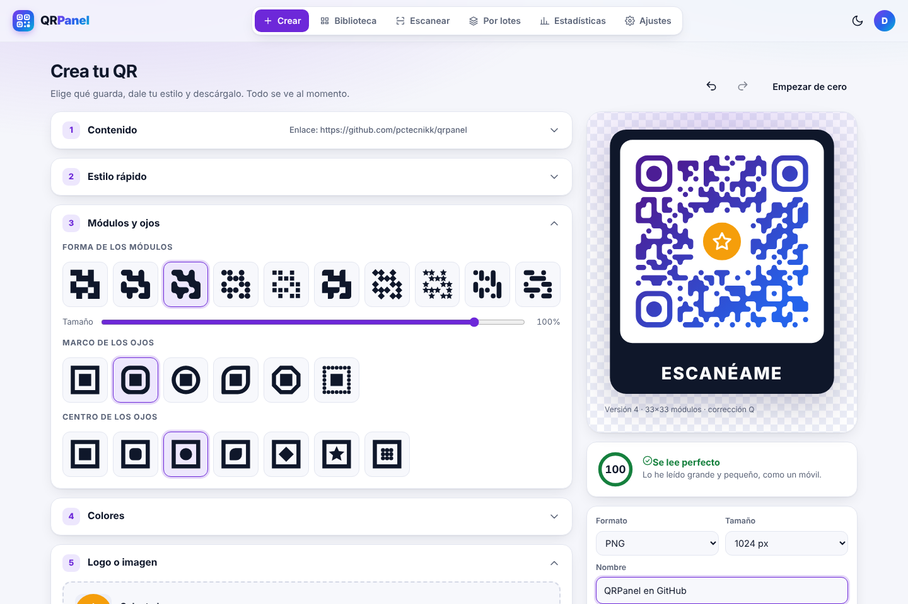

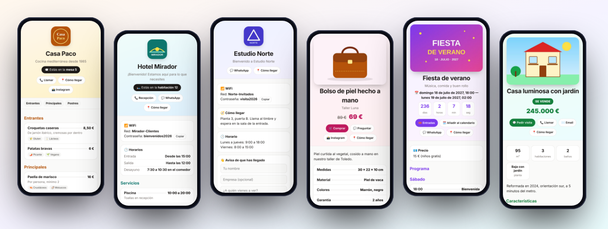

| | |
|---|---|
| 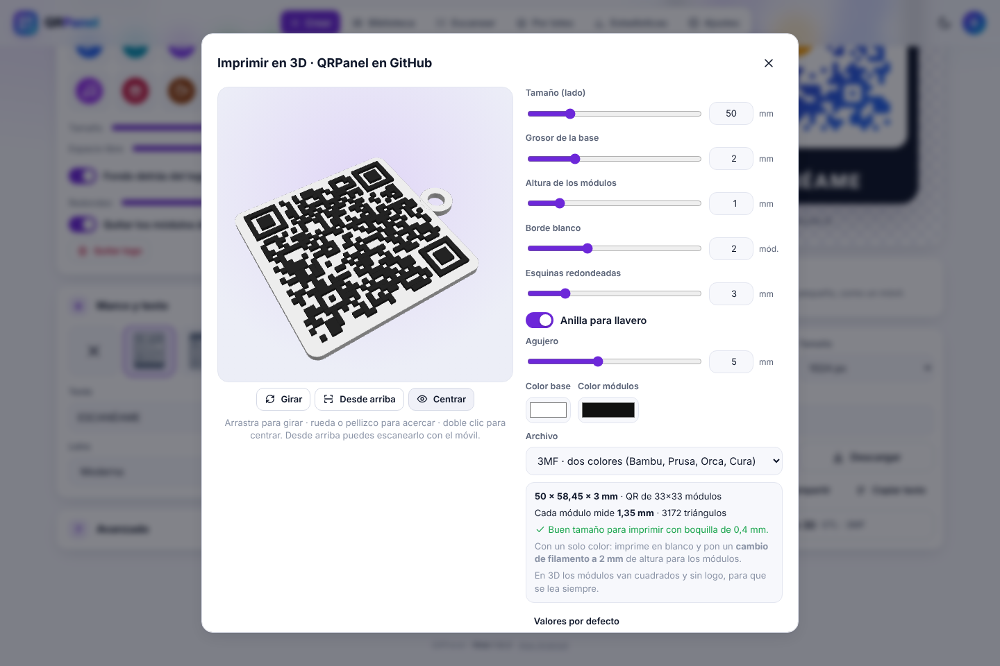 |  |
| **Imprimir en 3D**, con vista previa | **QR para tu mascota** |
|  | 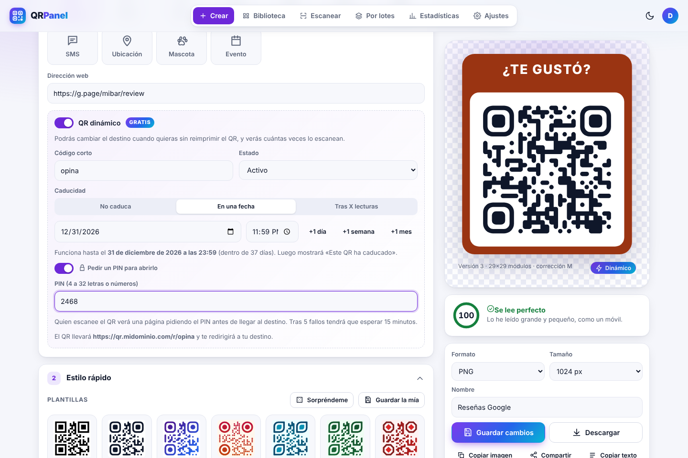 |
| **Estadísticas** de cada QR dinámico | **Caducidad y PIN** |
| 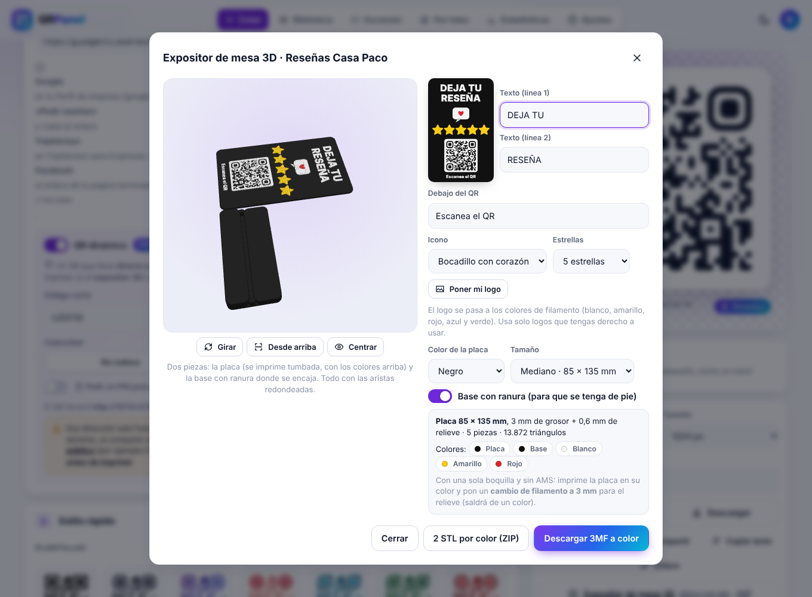 | 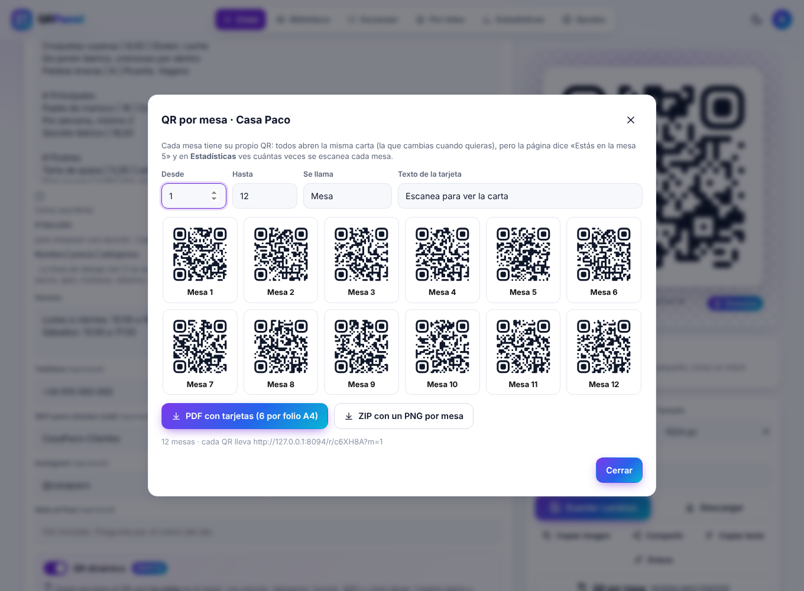 |
| **Expositor de reseñas** para imprimir en 3D | **QR por mesa** para la carta |
| 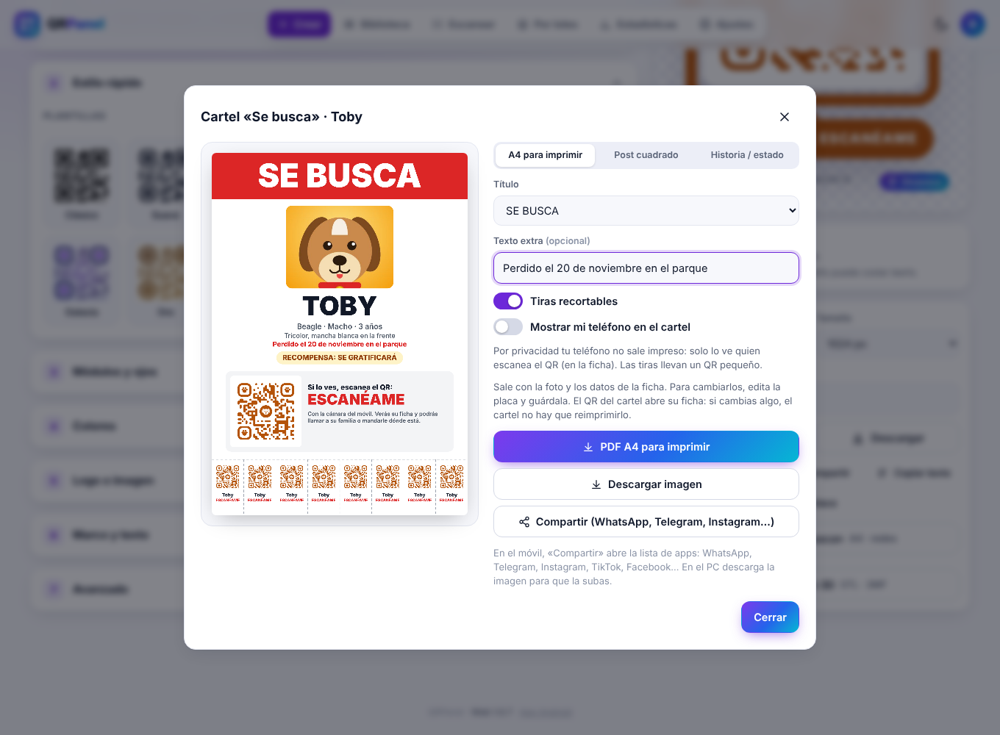 | |
| **Cartel «Se busca»** si se pierde tu mascota | |


<details>
<summary><b>Más capturas</b></summary>

| | |
|---|---|
| 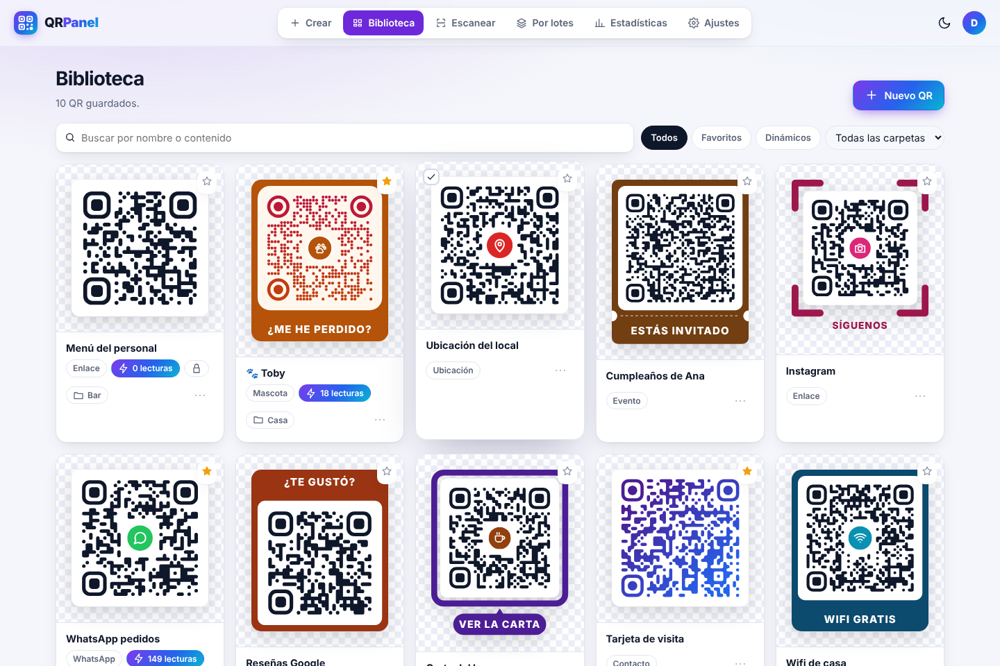 | 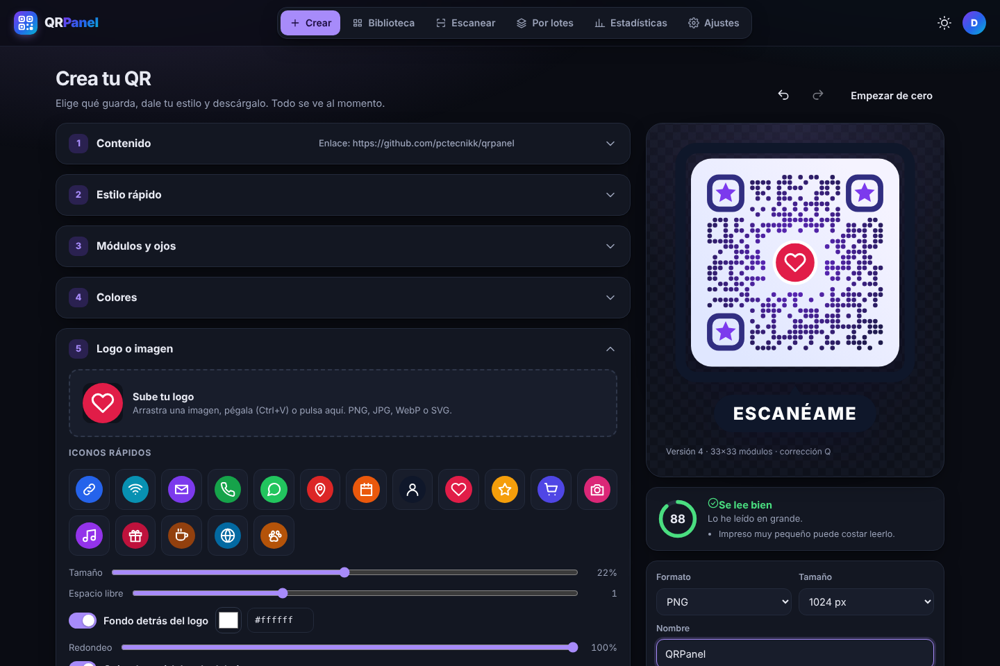 |
| **Biblioteca** con carpetas y favoritos | **Modo oscuro** |
| 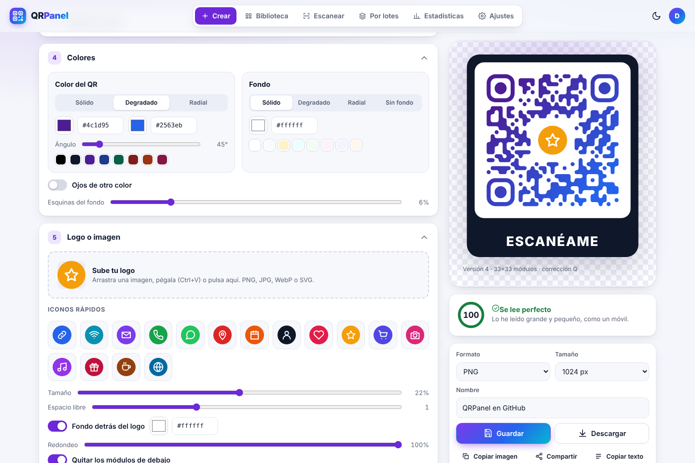 |  |
| **Colores y degradados** | **Estadísticas** de todos tus QR |
|  |  |
| **Escáner** con cámara o imagen | **Por lotes**: muchos QR de golpe |
|  |  |
| **Ajustes**: dirección pública, marca y usuarios | **Pantalla de entrada** |
| 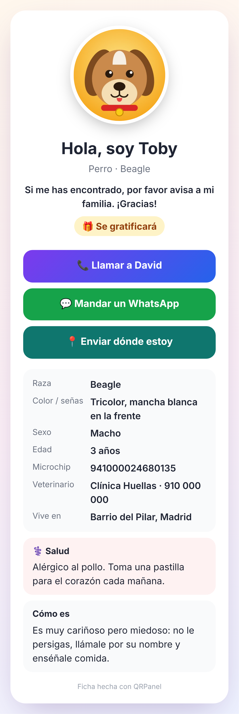 | 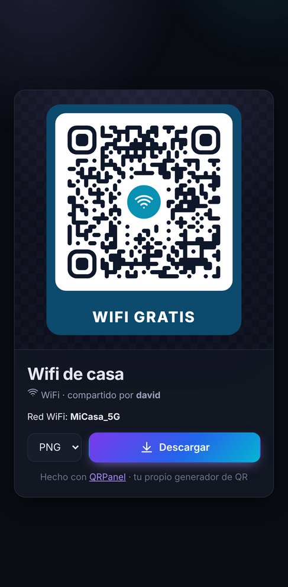 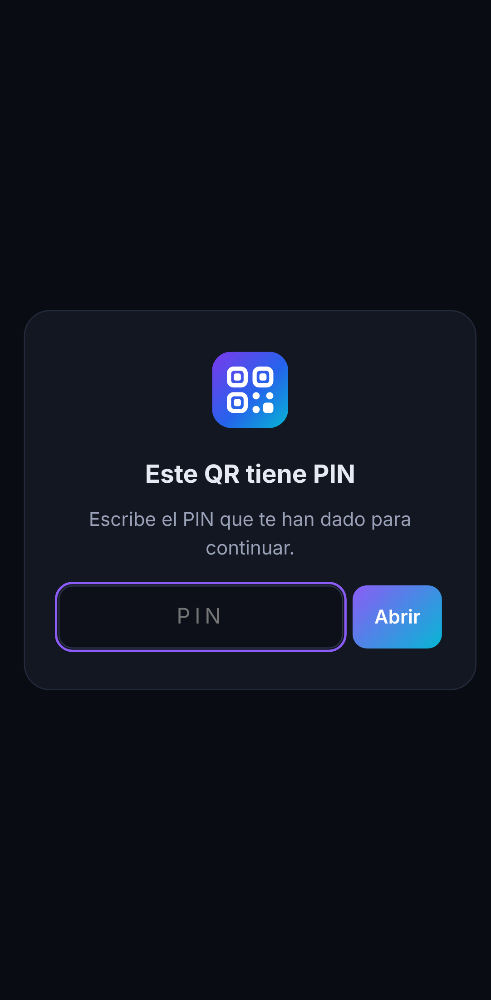 |
| **Ficha de la mascota** que ve quien la encuentra | **Página pública** de un QR compartido y **página del PIN** |

</details>

**Material gráfico:** portadas para redes, imagen para GitHub, icono y avatar en
[`docs/promo/`](docs/promo/) (lista completa en la [guía](docs/GUIA.md#17-material-gráfico-portadas-icono-y-avatar)).

---

## Qué es un QR dinámico (y por qué te interesa)

Un QR normal lleva dentro el destino tal cual (por ejemplo `https://mibar.com/carta`). Si
mañana cambia la dirección, tienes que imprimirlo otra vez.

Un QR dinámico lleva dentro una dirección corta de **tu** QRPanel (por ejemplo
`https://qr.midominio.com/r/carta`). Cuando alguien lo escanea, QRPanel apunta la lectura y
lo manda al destino. Así puedes:

- **Cambiar el destino** cuando quieras sin reimprimir nada.
- **Ver cuántas veces lo escanean**, cuándo y desde qué tipo de móvil.
- **Pausarlo**, decidir si **caduca o no** (en una fecha o tras X lecturas) y ponerle un
  **PIN** para que solo lo abra quien lo sepa.

Las webs de QR suelen cobrar por esto, y si dejas de pagar tus QR impresos dejan de
funcionar. Con QRPanel son tuyos para siempre.

> **Importante:** para que un QR dinámico funcione en cualquier móvil, tu QRPanel tiene que
> verse desde internet (mira [Acceso desde fuera de casa](#8-acceso-desde-fuera-de-casa)) y
> tienes que poner tu **dirección pública** antes de imprimirlo. Si no, solo funcionará
> conectado a tu WiFi.

---

## 1. Requisitos

- Una Raspberry Pi 3/4/5, un mini PC o cualquier equipo Linux (Raspberry Pi OS de 32 o
  64 bits, Debian, Ubuntu…) con **Docker** y **Docker Compose**. Funciona en procesadores
  Intel/AMD (amd64) y ARM (arm64 y armv7). Gasta unos 55 MB de memoria, así que va bien
  incluso en una Pi 3 con 1 GB.
  Si no lo tienes: `curl -fsSL https://get.docker.com | sh` y luego
  `sudo usermod -aG docker $USER` (cierra la sesión y vuelve a entrar).
- Para los QR dinámicos, un dominio o subdominio que apunte a tu servidor (opcional).

## 2. Instalar

```bash
git clone https://github.com/pctecnikk/qrpanel.git
cd qrpanel
./install.sh       # la primera vez solo crea el archivo .env con tu usuario
nano .env          # elige DATA_DIR y, si tienes dominio, PUBLIC_URL
./install.sh       # ahora sí instala y arranca
```

La primera instalación tarda un par de minutos. La base de datos (SQLite) se crea sola
dentro de `DATA_DIR/config/` al arrancar.

**Con la imagen ya hecha** (sin compilar nada), cambia en `docker-compose.yaml` la línea
`build: .` por `image: ghcr.io/pctecnikk/qrpanel:latest` y quita `image: qr-panel:latest`.
La imagen sirve para PC (amd64) y Raspberry Pi (arm64 y arm/v7).

### Primer acceso

Abre **http://IP-DE-TU-SERVIDOR:8091** y crea tu cuenta. **El primer usuario es el
administrador.** Los siguientes quedan pendientes hasta que los apruebes en
**Ajustes → Usuarios** (ahí también creas cuentas, bloqueas, cambias contraseñas o las
eliminas).

### Instalar la app en el móvil o el PC

- **Android / Chrome / Edge:** abre QRPanel y pulsa **Ajustes → Instalar QRPanel** (o el
  menú del navegador → *Instalar aplicación*).
- **iPhone / iPad:** en Safari, **Compartir → Añadir a pantalla de inicio**.

> La cámara del escáner y la instalación como app necesitan **https** (o `localhost`). Con
> `http://192.168…` el resto funciona, pero el navegador no deja usar la cámara: en ese caso
> usa **Leer desde una imagen**.

## 3. Configuración (`.env`)

| Variable | Para qué sirve | Por defecto |
|---|---|---|
| `DATA_DIR` | Carpeta donde se guarda todo | `./data` |
| `PORT` | Puerto de la web | `8091` |
| `TZ` | Zona horaria (para las estadísticas) | `Europe/Madrid` |
| `PUID` / `PGID` | Usuario y grupo dueños de los archivos | `1000` |
| `PUBLIC_URL` | Dirección pública para los QR dinámicos (`https://qr.midominio.com`) | vacío = la de la web |
| `ADMIN_USER` / `ADMIN_PASSWORD` | Crea ese administrador al arrancar si no existe | vacío |
| `ALLOW_REGISTER` | `1` = cualquiera puede pedir cuenta (el admin la aprueba); `0` = solo el admin crea cuentas | `1` |

La dirección pública también se puede poner desde la web en **Ajustes → Dirección
pública** (tiene prioridad sobre `PUBLIC_URL`). Después de cambiar el `.env`:
`docker compose up -d`.

**Qué hay dentro de `DATA_DIR`:** solo `config/qrpanel.db`, la base de datos con usuarios,
QR, logos, plantillas y lecturas. Para hacer una copia de seguridad basta con copiar esa
carpeta (o usar **Ajustes → Copia de seguridad → Exportar**).

## 4. Actualizar

Entra por SSH en el servidor y pega esta línea. Sirve desde cualquier carpeta:

```bash
curl -fsSL https://raw.githubusercontent.com/pctecnikk/qrpanel/main/update.sh | bash
```

Busca dónde está instalado QRPanel, baja el código nuevo, reconstruye, arranca y te dice la
versión que tenías y la que tienes ahora. Si ya estás en la carpeta de QRPanel, también vale
`./update.sh`.

Tus datos no se tocan: están en `DATA_DIR`, y tampoco se cambian tu `.env` ni tu
`docker-compose.yaml`. Si lo instalaste con la imagen ya hecha (CasaOS, Runtipi o
`image: ghcr.io/...`), el mismo comando baja la imagen nueva.

## 5. App para Android (APK)

> ⚠️ **Antes de nada: la app necesita tu propio servidor QRPanel ya instalado y funcionando**
> (en una Raspberry Pi o cualquier Linux con Docker). La app solo es la ventana para entrar en
> él desde el móvil: sin servidor no hace nada. Si aún no lo tienes, sigue primero los pasos de
> **[Instalar](#2-instalar)** y comprueba que entras desde el navegador.

Es la misma web de QRPanel dentro de una app, así que siempre está al día con tu servidor.

**Instalarla en el móvil:**

1. Abre en el móvil la página de **[descargas (Releases)](https://github.com/pctecnikk/qrpanel/releases)**,
   busca la más nueva que se llama **App Android** y toca **`QRPanel.apk`**.
2. Al abrir el archivo, Android pedirá permiso para **instalar apps de origen desconocido**.
   Dale permiso y toca **Instalar**. Si aparece *Play Protect*, toca **Más detalles →
   Instalar de todas formas**: sale porque la app no viene de Google Play.
3. Abre **QRPanel**. Te pide dos direcciones:
   - **En casa (wifi):** la IP de tu servidor, por ejemplo `192.168.1.x:8091`.
   - **Fuera de casa:** tu dominio, por ejemplo `https://qr.midominio.com` (mira
     [Acceso desde fuera de casa](#8-acceso-desde-fuera-de-casa)). Si no tienes, déjala vacía.
4. Entra con tu **usuario y contraseña**, los mismos de la web.

**Casa y fuera, sin tocar nada:** cada vez que abres la app prueba primero la dirección de
casa (tarda como mucho 2-3 segundos) y, si no responde porque estás con datos o en otra wifi,
entra por la de fuera. Si una falla, la app te deja usar la otra o cambiarlas.

**Qué hace:**

- Todo lo de la web: crear, diseñar, guardar, ver estadísticas, escanear y hacer lotes.
- **Descargas** (PNG, SVG, JPG, PDF, ZIP) directas a la carpeta **Descargas/QRPanel** del móvil.
- **Compartir la imagen del QR** por WhatsApp, Telegram, correo o cualquier app (botón
  **Compartir** del editor o **Compartir imagen** en el menú de cada QR de la biblioteca).
- **Escanear con la cámara.** Si entras por `http://` en casa, la cámara en directo no se
  puede usar (Android solo la deja con https): toca **O haz una foto** y la lee igual.
- **Atajos:** mantén pulsado el icono para ir directo a *Crear QR*, *Escanear* o *Cambiar servidor*.
- **Menú de la app:** pulsa **Atrás** en la pantalla principal: *Cambiar servidor*,
  *Recargar*, *Novedades* y *Salir*. También en **Ajustes → App de Android**.

Necesita Android 7 o más nuevo. En iPhone no hay app: abre QRPanel en Safari y usa
**Compartir → Añadir a pantalla de inicio**.

### Versiones: la web y la app van por separado

QRPanel tiene **dos números de versión**, cada uno con su propio ritmo:

| Qué | Dónde está el número | Dónde lo ves | Novedades |
|---|---|---|---|
| **Web (servidor)** | [`app/VERSION`](app/VERSION) | abajo de cada página y en **Ajustes → Acerca de** («Web 1.0.14») | [`CHANGELOG.md`](CHANGELOG.md) |
| **App Android** | `versionName` en [`android/src/main/AndroidManifest.xml`](android/src/main/AndroidManifest.xml) | abajo de cada página («App 1.0.1», solo dentro de la app) y en el menú *Atrás* | [`novedades.md`](android/src/main/res/raw/novedades.md) |

**Cómo se numeran:** siempre de poco en poco, subiendo solo el último número en cada
actualización: la web 1.0.0 → 1.0.1 → 1.0.2 → 1.0.3… y la app igual, 1.0.0 → 1.0.1 → 1.0.2…
Si un cambio solo toca la web, la app no cambia de versión (y al revés).

<details>
<summary>Compilar la APK tú mismo y sacar una versión nueva</summary>

El código está en [`android/`](android/). No hace falta Android Studio. En Ubuntu o Debian:

```bash
sudo apt install default-jdk aapt apksigner zipalign dalvik-exchange
./android/build.sh
```

La APK queda en `android/build/`. Sin más opciones se firma con una clave de prueba. Para
firmarla con la tuya (necesaria para que las actualizaciones se instalen encima):

```bash
keytool -genkeypair -keystore mi-clave.jks -alias qrpanel -keyalg RSA -keysize 2048 -validity 10000
KEYSTORE=mi-clave.jks KS_PASS=tu-contraseña KEY_ALIAS=qrpanel ./android/build.sh
```

> Guarda bien esa clave y su contraseña **fuera del repositorio**. Si la pierdes, las
> próximas versiones no se podrán instalar encima: habría que desinstalar la app.

**Sacar una versión nueva de la app:** sube `versionCode` (uno más) y `versionName` en
`android/src/main/AndroidManifest.xml`, apunta las novedades arriba del todo en
`android/src/main/res/raw/novedades.md`, compila con tu clave, copia la APK a
`android/dist/QRPanel.apk` y súbelo a `main`. GitHub crea solo la Release `android-vX.Y.Z`
con la APK y las novedades.

**Sacar una versión nueva de la web:** cambia el número de `app/VERSION`, apunta las
novedades en `CHANGELOG.md` y súbelo. La imagen Docker se publica sola.

</details>

## 6. Desinstalar

Un solo comando, desde la carpeta de QRPanel. Pregunta antes de borrar nada y ofrece una
copia de seguridad:

```bash
bash uninstall.sh
```

1. Pide que escribas `DESINSTALAR` para seguir (si no, no toca nada).
2. Ofrece **copia de seguridad** de los datos en `~/qrpanel-copia-FECHA.tar.gz`.
3. Para y borra el **contenedor** y la **imagen** de Docker.
4. Pregunta si borrar también los **datos** (la carpeta `DATA_DIR`: QR, logos, usuarios y
   estadísticas). Hay que escribir `BORRAR` para confirmarlo; si dices que no, se conservan.
5. Pregunta si borrar la **carpeta del programa**.
6. Se despide con un mensaje de agradecimiento. 🙂

Después quita el recurso de QRPanel en tu proxy si lo tenías. La app de Android se
desinstala como cualquier otra, desde el móvil.

## 7. Comandos útiles

```bash
docker compose ps                 # estado
docker compose logs -f            # ver registros (Ctrl+C para salir)
docker compose restart            # reiniciar
docker compose down               # parar
```

## 8. Acceso desde fuera de casa

Para que los QR dinámicos funcionen con datos móviles, QRPanel tiene que verse desde
internet con **https**. No abras el puerto 8091 directamente en el router: usa un proxy
inverso con HTTPS (Caddy, Nginx Proxy Manager, Traefik, Pangolin, Cloudflare Tunnel…) que
apunte a `http://IP-DE-TU-SERVIDOR:8091`. Luego pon esa dirección en
**Ajustes → Dirección pública**.

Ejemplo con Caddy:

```
qr.midominio.com {
    reverse_proxy IP-DE-TU-SERVIDOR:8091
}
```

## 9. Seguridad

- Las contraseñas se guardan como hash PBKDF2, nunca tal cual.
- Tras varios intentos fallidos de entrar se bloquea un rato a quien lo intenta.
  Si no quieres que desconocidos pidan cuenta, pon `ALLOW_REGISTER=0`.
- Cambiar la contraseña cierra las demás sesiones abiertas.
- Los QR dinámicos solo pueden llevar a direcciones `https://`, `http://`, `mailto:`,
  `tel:`, `sms:` y `geo:` (nunca código).
- Los PIN de los QR se guardan cifrados (PBKDF2). Tras 5 PIN mal puestos se bloquea
  15 minutos a quien lo intenta, y si llegan muchos fallos de sitios distintos se bloquea
  ese QR media hora. La página del PIN no enseña el nombre ni el destino.
- La app de Android solo abre dentro tu servidor; los enlaces de fuera se abren en el navegador.
- Las lecturas no guardan la IP: solo un identificador anónimo por día para contar
  visitantes únicos. Se borran solas a los dos años.
- La web lleva una política de seguridad estricta (CSP) y no carga nada de fuera.

## 10. Aviso legal y privacidad (si lo abres a otras personas)

Si solo lo usas tú o tu familia, no tienes que hacer nada. Si dejas que otras personas
creen cuentas o publicas QR dinámicos para el público, ten en cuenta que **quien instala
QRPanel es el responsable** de lo que se hace con él:

- **Qué datos guarda:** de cada usuario, su nombre de usuario y la contraseña cifrada. De
  cada lectura de un QR dinámico: la fecha y hora, el tipo de dispositivo, el sistema y el
  navegador, y un identificador anónimo que cambia cada día (sale de mezclar la IP y el
  navegador, y la IP no se guarda). No usa cookies de seguimiento ni manda nada a terceros.
- **Para el RGPD**, como dueño de la instalación eres el responsable del tratamiento.
  Si es para un negocio, añade en tu web una nota de privacidad que explique que los QR
  dinámicos cuentan lecturas anónimas.
- **Abusos:** cualquiera con cuenta puede crear QR que lleven a cualquier web. Por eso las
  cuentas nuevas necesitan tu aprobación (o pon `ALLOW_REGISTER=0`). Si alguien lo usa para
  algo ilegal, bloquea su cuenta en **Ajustes → Usuarios**.
- **Marcas:** QRPanel no incluye logos de otras empresas. Los iconos rápidos son dibujos
  genéricos propios. Si un usuario sube el logo de otra marca, la responsabilidad es suya.

## 11. Licencia

QRPanel se publica con la licencia [PolyForm Noncommercial 1.0.0](LICENSE.md). En resumen
(el texto que vale es el de la licencia):

- ✅ Puedes usarlo gratis en tu casa, para ti, tu familia, tus amigos, un colegio o una
  asociación sin ánimo de lucro.
- ✅ Puedes ver el código, modificarlo y compartir tus cambios, siempre que mantengas el
  aviso de licencia y de autor.
- ❌ **No puedes venderlo** ni usarlo con fines comerciales (por ejemplo cobrar por
  instalarlo u ofrecerlo como servicio de pago).

Si quieres usarlo con fines comerciales, escribe al autor por GitHub.

Incluye dos bibliotecas de terceros, sin cambios y con sus propias licencias:
*qrcode-generator* (Kazuhiko Arase, MIT) y *jsQR* (Cosmo Wolfe, Apache 2.0). Sus textos
completos están en [`app/static/vendor/`](app/static/vendor/LICENSES.txt). Todo lo demás
(código, diseño, iconos y plantillas) es original y no se ha copiado de ningún otro
generador. No incluye fuentes tipográficas: usa las del sistema.
"QR Code" es una marca registrada de DENSO WAVE INCORPORATED.

Copyright (c) 2026 [pctecnikk](https://github.com/pctecnikk)
