# Guía de QRPanel, paso a paso

Todo lo que se puede hacer con QRPanel, con capturas. Si aún no lo tienes instalado, mira
primero el [README](../README.md).

**Índice**

1. [Entrar por primera vez](#1-entrar-por-primera-vez)
2. [Crear tu primer QR](#2-crear-tu-primer-qr)
3. [Darle tu estilo](#3-darle-tu-estilo)
4. [Descargar, copiar y compartir](#4-descargar-copiar-y-compartir)
5. [QR dinámicos: cambiar el destino sin reimprimir](#5-qr-dinámicos-cambiar-el-destino-sin-reimprimir)
6. [Caducidad y PIN](#6-caducidad-y-pin)
7. [QR para tu mascota](#7-qr-para-tu-mascota)
8. [Imprimir en 3D (STL y 3MF)](#8-imprimir-en-3d-stl-y-3mf)
9. [Biblioteca](#9-biblioteca)
10. [Estadísticas](#10-estadísticas)
11. [Escanear un QR](#11-escanear-un-qr)
12. [Muchos QR de golpe (por lotes)](#12-muchos-qr-de-golpe-por-lotes)
13. [Ajustes: dirección pública, tu marca y usuarios](#13-ajustes-dirección-pública-tu-marca-y-usuarios)
14. [En el móvil y la app de Android](#14-en-el-móvil-y-la-app-de-android)
15. [Versiones](#15-versiones)
16. [Material gráfico (portadas, icono y avatar)](#16-material-gráfico-portadas-icono-y-avatar)

---

## 1. Entrar por primera vez

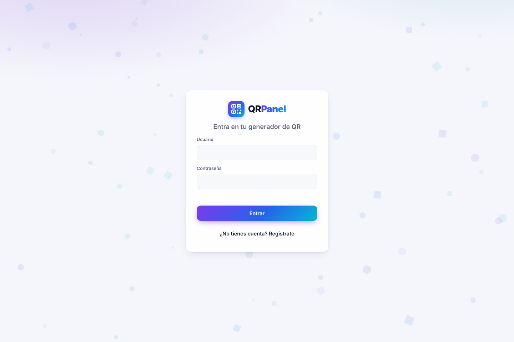

- La **primera cuenta** que se crea es la del **administrador**. Escribe un usuario y una
  contraseña larga.
- Las siguientes personas pueden **pedir cuenta** desde la misma pantalla. No podrán entrar
  hasta que el administrador las apruebe en **Ajustes → Usuarios** (o desactiva el registro
  con `ALLOW_REGISTER=0`).

## 2. Crear tu primer QR

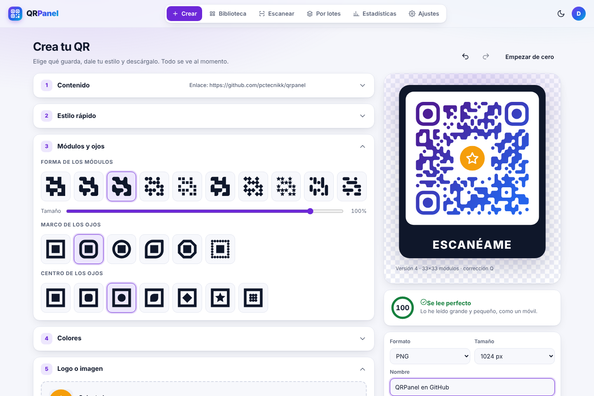

1. En **Crear**, elige qué guarda el QR: **Enlace, Texto, WiFi, Contacto, Email, WhatsApp,
   Llamada, SMS, Ubicación, Evento o Mascota**.
2. Rellena los datos. La vista previa de la derecha cambia al momento.
3. Debajo de la vista previa verás una **nota de 0 a 100**: QRPanel lee el QR como lo haría un
   móvil (en grande y en pequeño). Si baja, te dice por qué (poco contraste, logo muy grande…).
4. Ponle un **nombre** y pulsa **Guardar**. Queda en tu biblioteca.

Atajos de teclado: **Ctrl+S** guardar · **Ctrl+Z** deshacer · **Ctrl+Y** rehacer ·
**Ctrl+V** pegar un logo.

## 3. Darle tu estilo

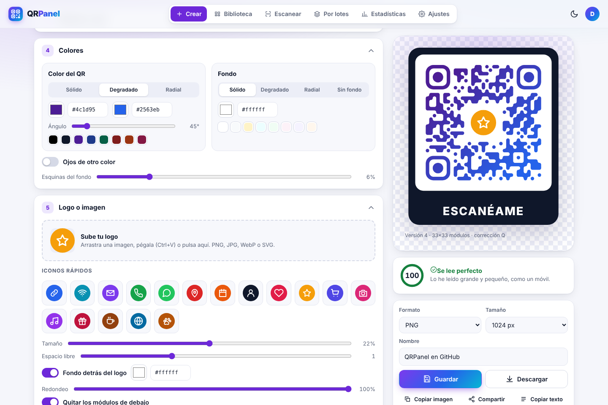

El editor tiene 7 pasos que se abren y se cierran:

| Paso | Qué cambias |
|---|---|
| **Estilo rápido** | 12 plantillas, **Sorpréndeme** (un diseño al azar que siempre se lee) y guardar las tuyas |
| **Módulos y ojos** | 10 formas de módulo, 6 marcos y 7 centros para los ojos |
| **Colores** | Color sólido o degradado (lineal o radial), fondo de color, degradado o transparente, esquinas redondeadas |
| **Logo o imagen** | Sube tu logo (arrastrar, pegar o elegir) o usa uno de los iconos rápidos |
| **Marco y texto** | Tarjeta, cinta, bocadillo, esquinas o entrada, con tu texto («ESCANÉAME») |
| **Avanzado** | Corrección de errores (con logo sube sola) y margen |

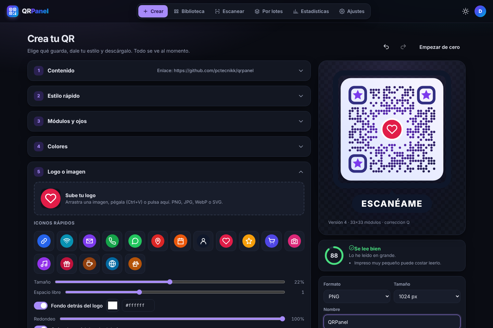

## 4. Descargar, copiar y compartir

En la parte derecha del editor:

- **Descargar** en **PNG, SVG** (vectorial, para imprenta), **JPG, WebP o PDF** (A4 listo
  para imprimir), hasta 4096 px.
- **Copiar imagen** para pegarla en un documento o un chat.
- **Compartir**: en el móvil y en la app manda la **imagen del QR** a WhatsApp, Telegram,
  correo o cualquier app.
- **Enlace** (cuando ya está guardado): crea una **página pública** del QR. Quien la abre lo
  ve y lo descarga sin cuenta, y al pegar el enlace en WhatsApp o Telegram sale con la imagen
  del QR. La quitas cuando quieras con **Dejar de compartir**.

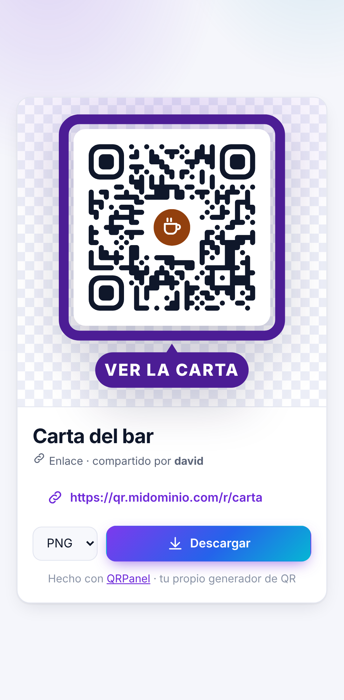

## 5. QR dinámicos: cambiar el destino sin reimprimir

Activa **QR dinámico** debajo del contenido. El QR llevará una dirección corta de tu QRPanel
(por ejemplo `https://qr.midominio.com/r/carta`) que manda al destino. Así puedes:

- **Cambiar el destino** cuando quieras, aunque el QR ya esté impreso.
- Ver **cuántas veces lo escanean**, cuándo y con qué tipo de móvil.
- **Pausarlo** (quien lo escanee verá un aviso).
- Elegir tu propio **código corto** (`/r/carta`, `/r/menu`…).

> **Antes de imprimir un QR dinámico**, pon tu dirección pública en **Ajustes → Dirección
> pública**. Si no, solo funcionará conectado a la wifi de casa.

## 6. Caducidad y PIN

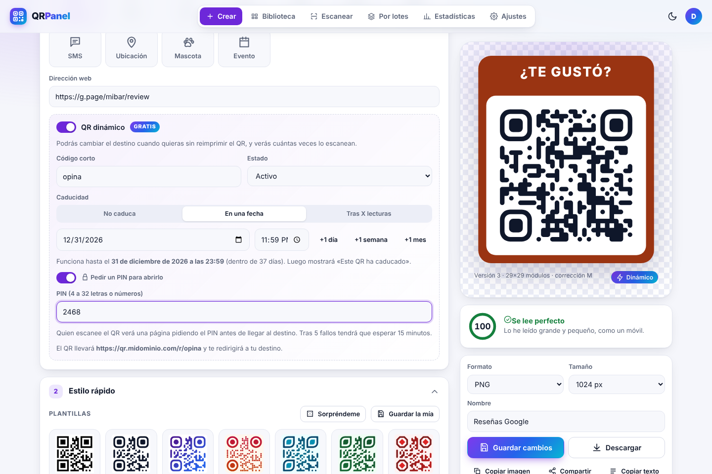

**Caducidad**, tú eliges:

- **No caduca**: funciona siempre.
- **En una fecha**: hasta el día y la hora que digas (con botones de +1 día, +1 semana y
  +1 mes). Después muestra «Este QR ha caducado».
- **Tras X lecturas**: deja de funcionar cuando lo escanean ese número de veces (por ejemplo,
  una invitación de un solo uso).

**PIN**: activa **Pedir un PIN para abrirlo** y escribe de 4 a 32 letras o números. Quien
escanee el QR verá esta página antes de llegar al destino:

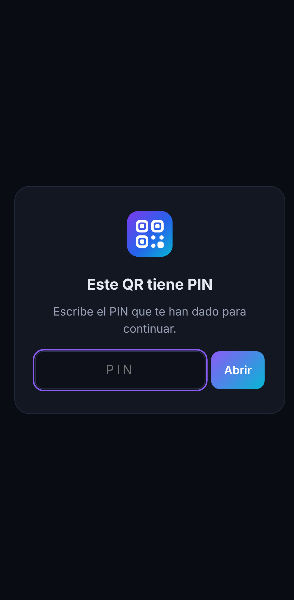

- El PIN se guarda **cifrado** (no se puede leer ni desde la base de datos).
- Tras **5 fallos** se bloquea 15 minutos a quien lo intenta, y si llegan muchos fallos de
  sitios distintos se bloquea ese QR media hora.
- La página del PIN no enseña ni el nombre ni el destino.

## 7. QR para tu mascota

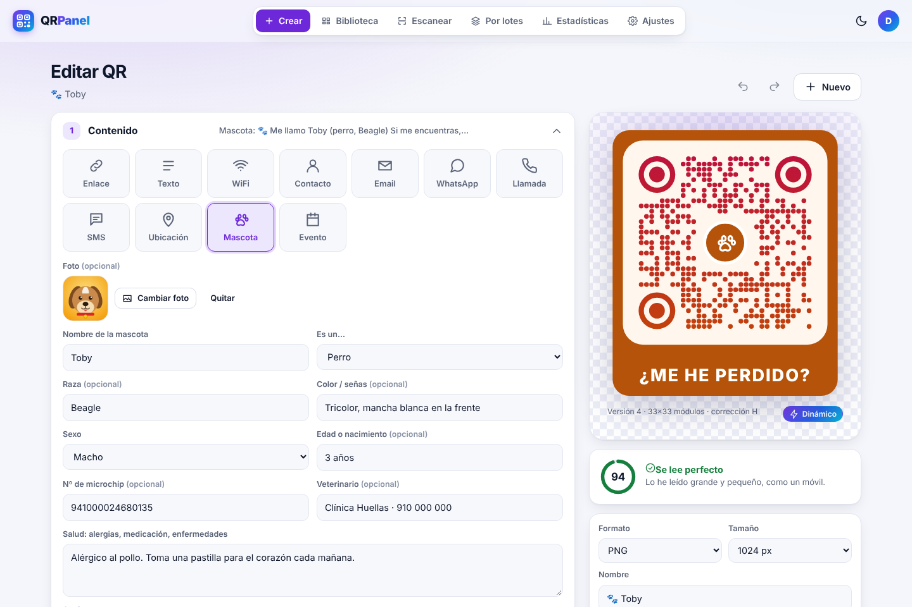

Elige el tipo **Mascota** y rellena:

- **Foto**, nombre, perro / gato / otro, raza, color o señas, sexo y edad.
- **Microchip** y **veterinario**.
- **Salud**: alergias, medicación, enfermedades.
- **Carácter** («es miedoso, no le persigas»).
- **Tus datos**: nombre, teléfonos, email, zona y **recompensa**.

Quien encuentre a tu mascota y escanee la placa verá su **ficha** con botones grandes para
**llamarte**, **mandarte un WhatsApp** o **enviarte dónde está** (te llega su ubicación en el
mapa por WhatsApp):

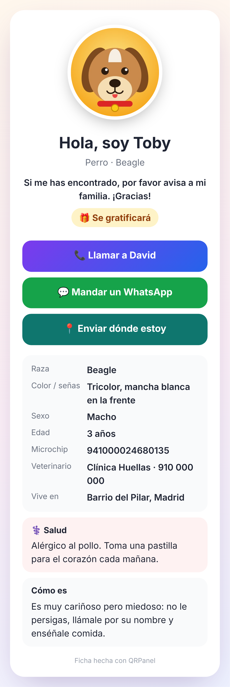

- Si se pierde, activa **Se ha perdido** y saldrá arriba un **aviso grande en rojo**.
- Puedes cambiar los datos (un teléfono nuevo, otra foto) **sin reimprimir la placa**.
- Con la [impresión en 3D](#8-imprimir-en-3d-stl-y-3mf) y la **anilla de llavero** te
  haces la placa para el collar.

## 8. Imprimir en 3D (STL y 3MF)

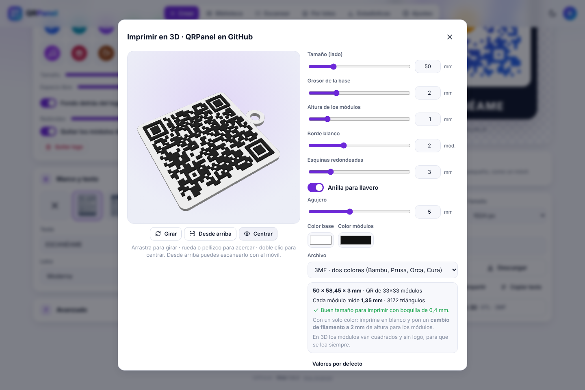

Pulsa **Imprimir en 3D** (debajo del editor o en el menú de cada QR de la biblioteca):

- La **vista previa 3D** se gira con el ratón o el dedo, se acerca con la rueda o
  pellizcando, y cambia al momento con cada ajuste. **Desde arriba** la pone de frente: puedes
  escanearla con el móvil para comprobar que se lee.
- Ajustas el **tamaño** (lado en mm), el **grosor de la base**, la **altura de los
  módulos**, el **borde blanco**, las **esquinas redondeadas** y la **anilla de llavero** (con
  el tamaño del agujero), y los **dos colores**.
- **Archivo**:
  - **3MF de dos colores**: base y módulos como dos piezas de un mismo objeto (Bambu Studio,
    PrusaSlicer, OrcaSlicer, Cura).
  - **STL** de una sola pieza.
  - **2 STL** en un ZIP (base y módulos), para cargarlos como piezas.
- Te avisa si los módulos quedan **demasiado pequeños** para una boquilla de 0,4 mm (mejor
  1,2 mm o más) y, si imprimes con **un solo color**, te dice a qué altura poner el
  **cambio de filamento**.
- En 3D los módulos van cuadrados y sin logo, para que se lea siempre.

## 9. Biblioteca

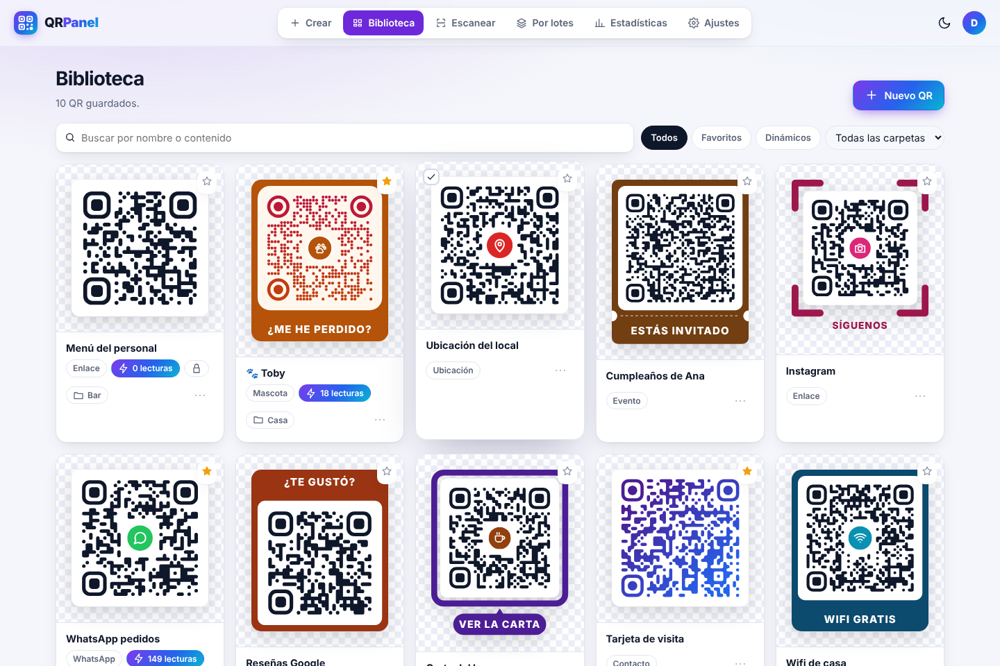

- Busca, filtra (**Favoritos**, **Dinámicos**) y ordena por **carpetas**.
- El menú **⋯** de cada QR: editar, descargar (PNG, SVG, JPG, PDF), **compartir imagen**,
  **imprimir en 3D**, compartir con un enlace, duplicar, renombrar, mover a carpeta, ver
  estadísticas, copiar el enlace corto, pausar y eliminar.
- Marca varios y descárgalos de golpe en un **ZIP**.

## 10. Estadísticas

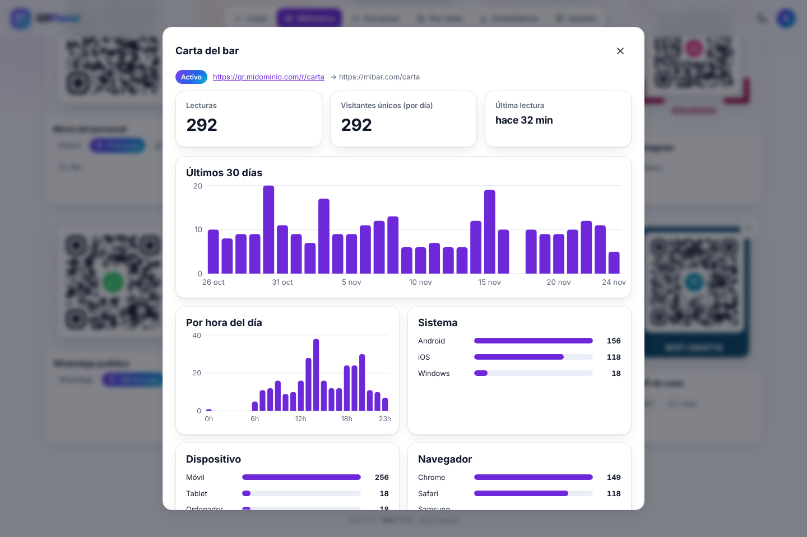

De cada QR dinámico: lecturas por día y por hora, visitantes únicos, dispositivos, sistemas
y navegadores, y las últimas lecturas. En **Estadísticas** tienes el resumen de todos:

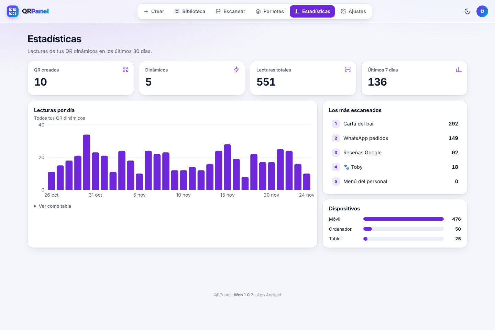

Las lecturas **no guardan la IP**: solo un identificador anónimo que cambia cada día.

## 11. Escanear un QR

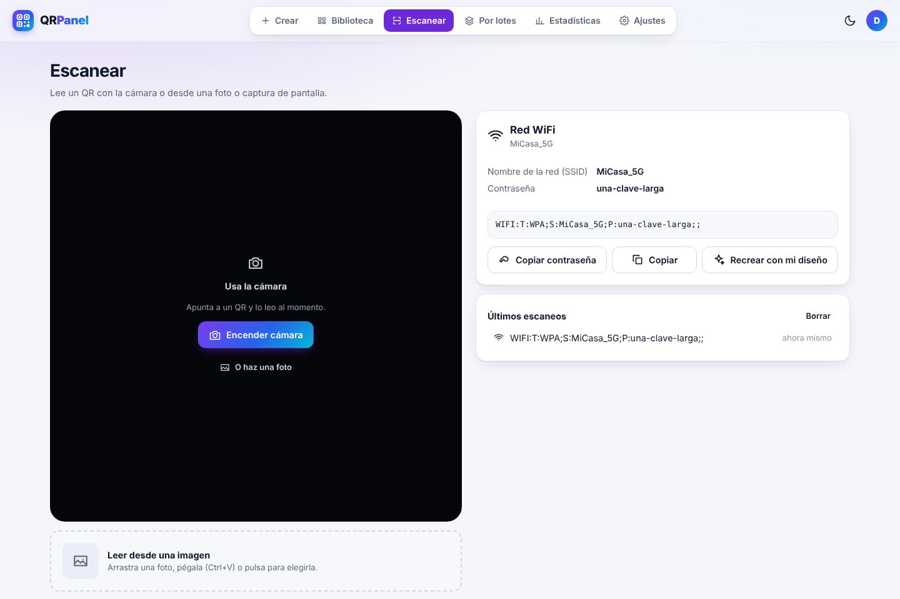

Lee QR con la **cámara** o desde una **foto o captura** (arrastrar, pegar o elegir).
Reconoce WiFi, contactos, eventos… y con **Recrear con mi diseño** lo vuelves a crear con tu
estilo. Si entras por `http://` y el navegador no deja usar la cámara en directo, pulsa
**O haz una foto**.

## 12. Muchos QR de golpe (por lotes)

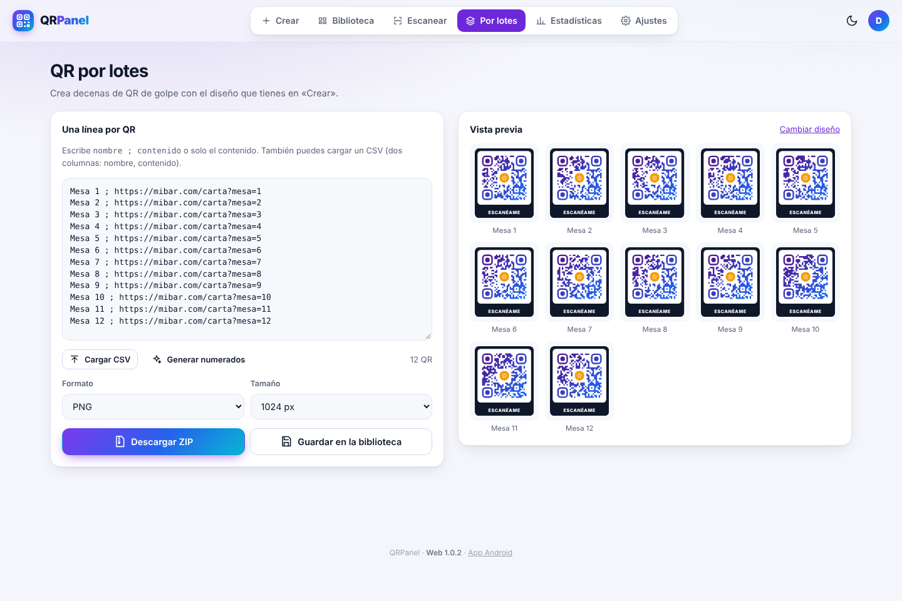

Pega una lista (una línea por QR, con `Nombre ; contenido`) o carga un **CSV**. Te hace todos
con el mismo diseño y los descargas en un **ZIP** o los guardas en la biblioteca. Ideal para
las mesas de un bar o las habitaciones de un hotel.

## 13. Ajustes: dirección pública, tu marca y usuarios

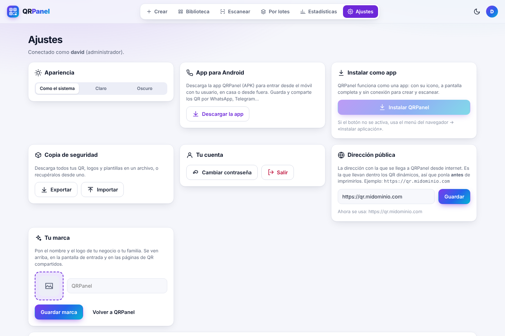

- **Apariencia**: claro, oscuro o como el sistema.
- **Copia de seguridad**: exporta e importa todos tus QR, logos y plantillas.
- **Tu cuenta**: cambiar la contraseña o salir.
- Solo el administrador:
  - **Dirección pública**: la que llevan dentro los QR dinámicos (por ejemplo
    `https://qr.midominio.com`).
  - **Tu marca**: el nombre y el logo de tu negocio o tu familia, que se ven arriba, en la
    entrada y en las páginas compartidas.
  - **Usuarios**: aprobar, bloquear, hacer administrador o borrar cuentas.

## 14. En el móvil y la app de Android

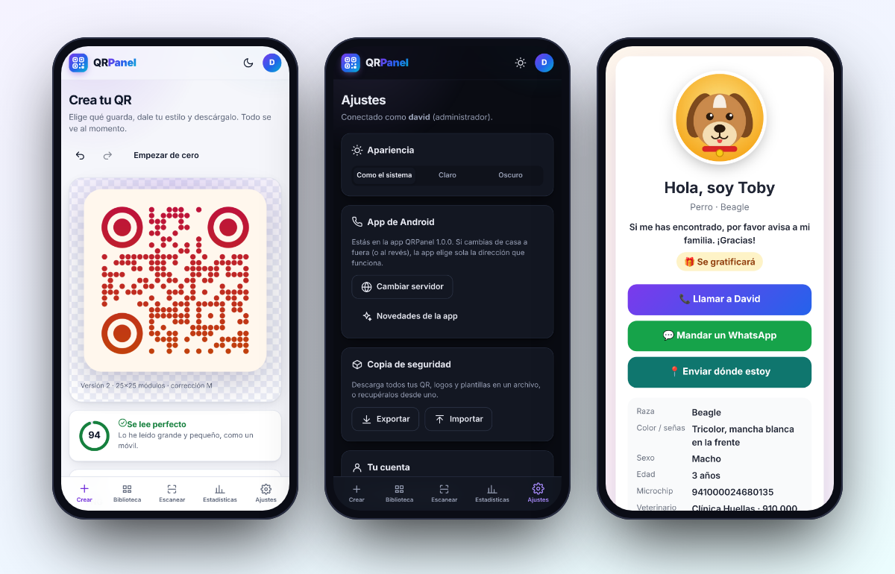

QRPanel se adapta al móvil. Además:

- **App para Android (APK)**: entra con tu usuario, en casa por la wifi y fuera por tu
  dominio, sin tocar nada. Las descargas van a la carpeta *Descargas/QRPanel* y el botón
  Compartir manda la imagen a WhatsApp, Telegram… En **Ajustes → App de Android** puedes
  **cambiar de servidor** y ver las **novedades**. Cómo instalarla: mira la sección
  *App para Android* del [README](../README.md).
- **iPhone, iPad u ordenador**: instálalo como app desde el navegador (en Safari:
  **Compartir → Añadir a pantalla de inicio**; en Chrome o Edge: **Instalar**).

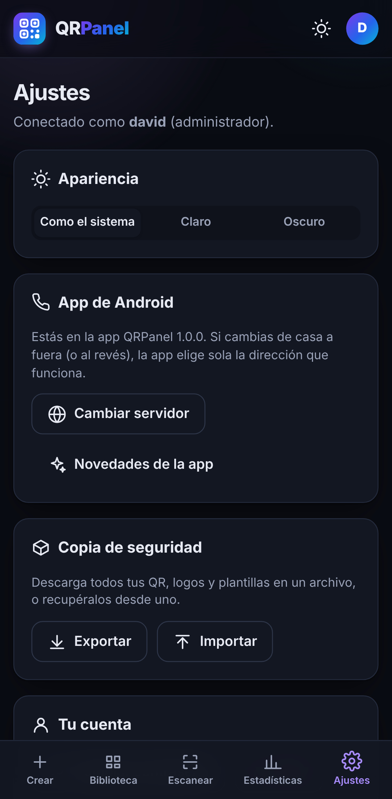

## 15. Versiones

La web y la app llevan **cada una su número**, y se ven **abajo del todo de cada página**
(«Web 1.0.2 · App 1.0.0») y en tu menú de usuario. Así sabes de un vistazo qué tienes.

- Web: [`app/VERSION`](../app/VERSION), novedades en [`CHANGELOG.md`](../CHANGELOG.md).
- App: `versionName` en `android/src/main/AndroidManifest.xml`, novedades en
  [`novedades.md`](../android/src/main/res/raw/novedades.md).
- Se sube **siempre de poco en poco**, solo el último número: 1.0.0 → 1.0.1 → 1.0.2…

## 16. Material gráfico (portadas, icono y avatar)

Todo está en [`docs/promo/`](promo/), listo para GitHub y redes sociales:

| Archivo | Para qué |
|---|---|
| [`qrpanel-enlace-1200x630.png`](promo/qrpanel-enlace-1200x630.png) | Vista previa al compartir un enlace (WhatsApp, Telegram, Facebook, X) |
| [`qrpanel-github-1280x640.png`](promo/qrpanel-github-1280x640.png) | Imagen del repositorio en GitHub (*Settings → Social preview*) |
| [`qrpanel-post-1080x1080.png`](promo/qrpanel-post-1080x1080.png) | Publicación cuadrada (Instagram, Facebook, LinkedIn) |
| [`qrpanel-historia-1080x1920.png`](promo/qrpanel-historia-1080x1920.png) | Historias y estados (Instagram, WhatsApp, TikTok) |
| [`qrpanel-mascotas-1080x1080.png`](promo/qrpanel-mascotas-1080x1080.png) | Publicación del QR para mascotas |
| [`qrpanel-3d-1080x1080.png`](promo/qrpanel-3d-1080x1080.png) | Publicación de la impresión en 3D |
| [`qrpanel-avatar-500.png`](promo/qrpanel-avatar-500.png) | Foto de perfil (se ve bien recortada en círculo) |
| [`qrpanel-icono-1024.png`](promo/qrpanel-icono-1024.png) | Icono en grande, fondo transparente |

| | | |
|---|---|---|
| 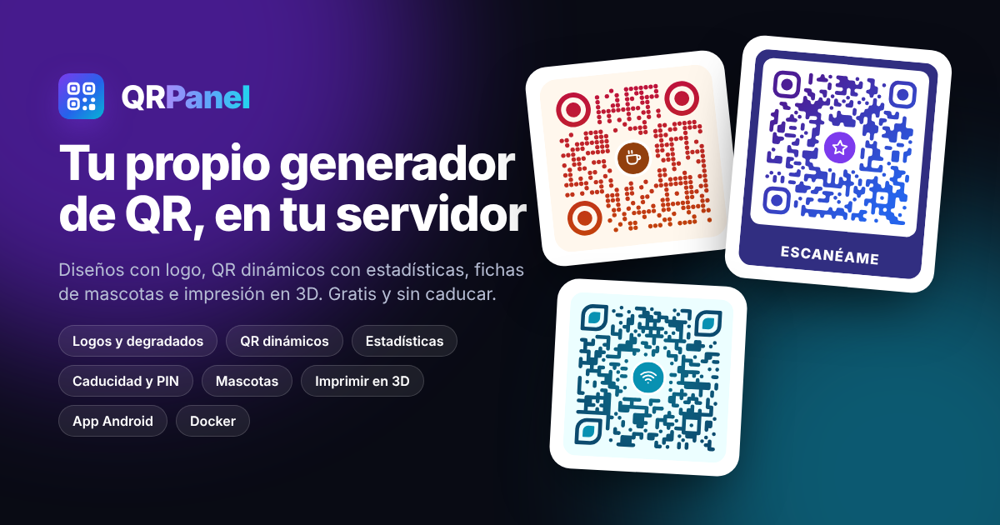 | 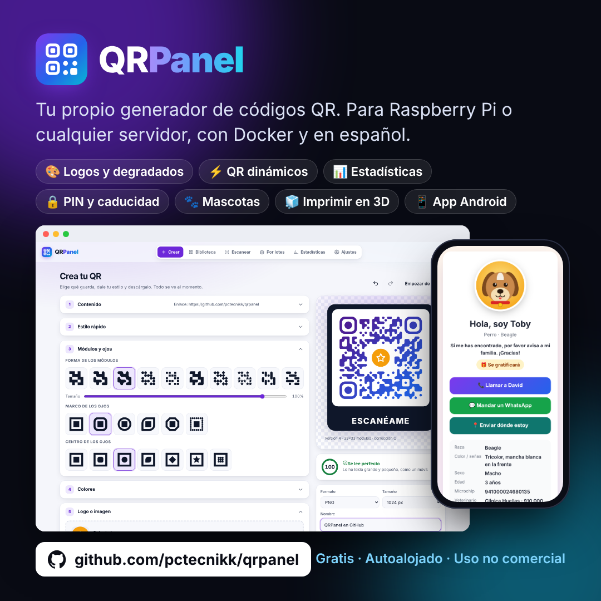 | 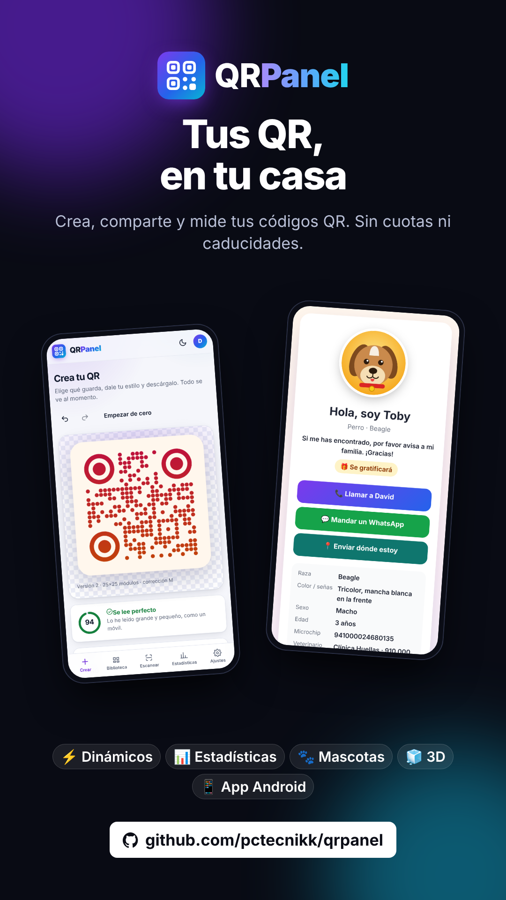 |
| 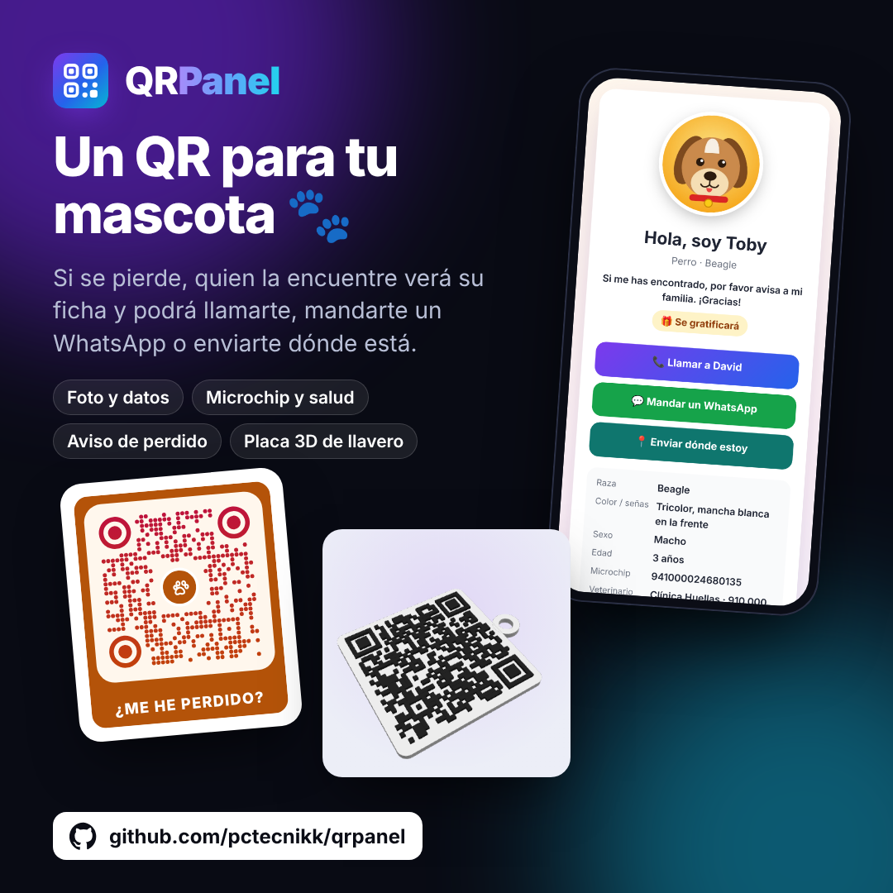 | 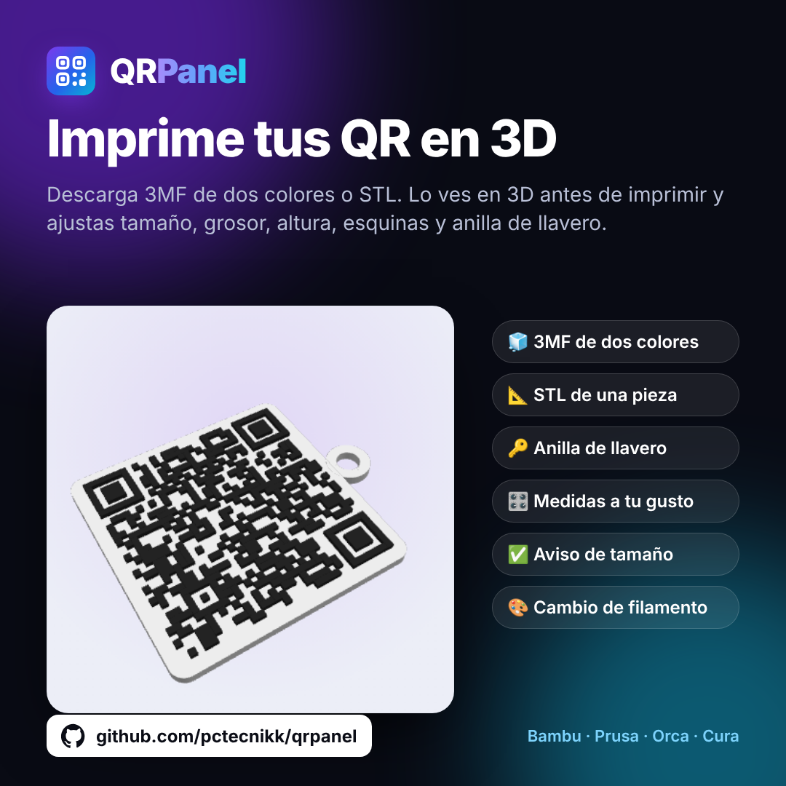 |  |
